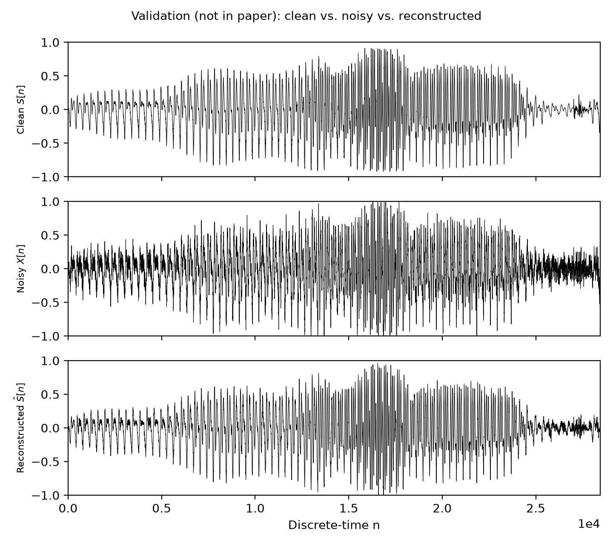
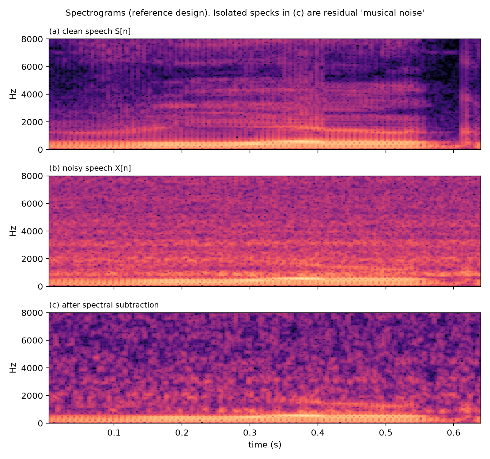
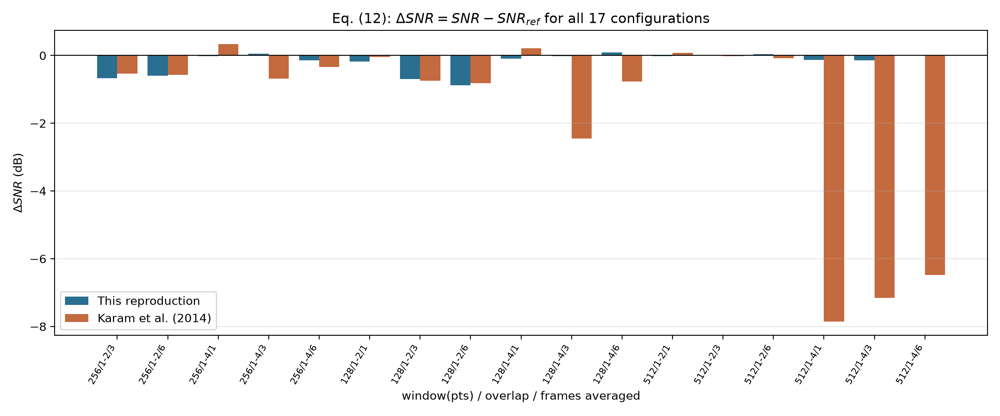

# Reproducing Karam et al. (2014) — Spectral Subtraction for Speech Denoising

[](https://www.python.org/)
[](https://doi.org/10.4236/jsip.2014.52006)
[](LICENSE)
[]()
[]()

A rigorous reproduction, validation, and critical analysis of **"Noise Removal in Speech Processing Using Spectral Subtraction"**  
*M. Karam, H. F. Khazaal, H. Aglan, and C. Cole*, **Journal of Signal and Information Processing**, 2014, **5**, 32–41.  
DOI: [10.4236/jsip.2014.52006](https://doi.org/10.4236/jsip.2014.52006) (Open Access, CC BY).

---


*Figure: Time-domain speech denoising validation — Clean speech $S[n]$, corrupted input $X[n]$ with real acoustic noise, and reconstructed output $\hat{S}[n]$ via Spectral Subtraction.*

---

## 📌 Executive Summary & Key Engineering Insights

This project implements an end-to-end discrete-time speech enhancement pipeline reproducing Sections 2–4 of Karam et al. (2014) based on Boll's magnitude spectral subtraction. Beyond straightforward reproduction, this study performs an **empirical audit of the original publication**:

- **Reproduced 17 Parameter Configurations:** Exact 221-buffer framing match ($L=256$, $hop=128$). All 8 half-overlap configurations reproduce the paper's claimed $\Delta\text{SNR}$ within **0.08 dB on average (0.14 dB worst-case)**.
- **Flawed Metric Exposed (Eq. 9):** Demonstrated that the paper's SNR formulation evaluates output *loudness/gain* rather than denoising quality (amplifying the output by $2\times$ falsely improves the score by $+6.02\text{ dB}$).
- **Formulated Level-Invariant Metric:** Designed a gain-matched SNR metric establishing a genuine **$+5.67\text{ dB}$ noise attenuation gain** across the reference configuration.
- **Debunked Adjacent Frame Averaging:** Proved that frame averaging smears acoustic transients and degrades true SNR in **12 of 12** configurations (and in 10 of 12 in the authors' own data).
- **Corrected Typographical & Mathematical Errors:** Resolved misprinted threshold equations (Eq. 7 condition corrected to $\tilde{S}[k] < 0$), periodic vs. symmetric window COLA violations, and indexing mismatches.

---

## 🎧 Audio Samples (Before & After)

| Audio Track | Description | Format | File |
|---|---|---|---|
| **Clean Speech** | Target phrase *"Real graph"* spoken by team member | 44.1 kHz, 16-bit mono | [🔊 Listen / Download](results/01_clean_speech.wav) |
| **Acoustic Noise** | Real-world hair dryer background noise (220V DC motor, ~25–30 cm) | 44.1 kHz, 16-bit mono | [🔊 Listen / Download](results/02_noise.wav) |
| **Noisy Mixture** | Unprocessed corrupted mixture ($X[n] = S[n] + N[n]$) | 44.1 kHz, 16-bit mono | [🔊 Listen / Download](results/03_noisy_speech.wav) |
| **Denoised Output** | Reconstructed speech after spectral subtraction | 44.1 kHz, 16-bit mono | [🔊 Listen / Download](results/04_denoised_speech.wav) |

---

## 🛠️ Core Competencies & DSP Techniques Demonstrated

- **Digital Signal Processing (DSP):** Short-Time Fourier Transform (STFT), Inverse FFT (IFFT), Constant Overlap-Add (COLA) constraint, Periodic Hann Windowing, Overlap-Add (OLA) Synthesis, Spectral Subtraction, Half-Wave Rectification, Noise Power Spectral Density (PSD) estimation, Phase preservation.
- **Scientific Python Stack:** NumPy (vectorized array operations, frame matrix indexing), SciPy (`scipy.signal`, `scipy.io.wavfile`), Matplotlib (3D STFT wireframes, narrowband spectrograms, comparative metric charts).
- **Research Auditing & Benchmarking:** Sensitivity analysis, parameter grid sweeps, acoustic recording and noise characterization, metric validation, scientific report generation.

---

## 📊 Spectrogram Analysis

<p align="center">
  
  <br>
  <em>Narrowband spectrograms showing harmonic speech recovery and musical noise suppression across the benchmark.</em>
</p>

---

## 📁 Repository Structure

| File / Folder | Role |
|---|---|
| `spectral_subtraction.py` | Core implementation: audio ingestion, Eqs. 1–12, 17-configuration sweep, report, and CSV export. |
| `figures.py` | Visualization module rendering Figures 1–9 (matched to the original publication and validation metrics). |
| `extra_analysis.py` | Extended validation: trial-to-trial repeatability, oracle noise estimation, noise-level sweep, and spectrograms. |
| `speech.wav` | Clean speech recording of the phrase *"Real graph"* (44.1 kHz, 16-bit mono). |
| `noise.wav` | Acoustic background noise recording (hair dryer MRD3880, 2-speed DC motor, ~25–30 cm). |
| `Noise_Removal_in_Speech_Processing_Using_Spectral_.pdf` | Original research article by Karam et al. (2014). |
| `requirements.txt` | Python package requirements (`numpy`, `scipy`, `matplotlib`). |
| `results/` | Output directory containing generated plots (Figs. 1–9), audio samples, report, and metrics CSV. |
| `analysis/` | Output directory of extended experiments (repeatability, input SNR sweep, spectrograms). |
| `sensitivity/` | 6 sensitivity experiments exploring unstated assumptions (framing, windowing, OLA normalization). |

---

## 📐 Mathematical Mapping

Where each equation from the paper is implemented in [`spectral_subtraction.py`](spectral_subtraction.py):

| Paper Reference | Implementation / Function |
|---|---|
| Eqs. 1–2 (sampling, $f_s = 44.1\text{ kHz}$, $N = 28,446$ samples) | `read_active`, `fit_length`, `FS`, `N_SAMPLES` |
| Eq. 3 (Periodic Hann / Hanning window) | `hanning_window` |
| Sec. 2.2 (Overlapped framing) | `hop_size` |
| Eq. 4 (Short-Time Fourier Transform / FFT per buffer) | `analyze` |
| Sec. 4.1 (Frame averaging over adjacent windows) | `average_frames` |
| Eqs. 5–7 (Noise spectrum average, spectral subtraction, half-wave rectification) | `run_configuration` |
| Eq. 8 (IFFT and Overlap-Add synthesis) | `synthesize` |
| Eqs. 9–11 (Paper's defined SNR metric) | `rms`, `snr_db` |
| Level-invariant / gain-matched true SNR | `snr_true_db` |
| Eq. 12, Tables 1–3 (17-configuration sweep) | `run_sweep`, `format_tables`, `write_report` |

---

## 🚀 How to Run

### 1. Requirements

- Python 3.6+
- `numpy >= 1.17`, `scipy`, `matplotlib`

Install dependencies:
```bash
pip install -r requirements.txt
```

### 2. Execution

Run the main reproduction script:
```bash
python spectral_subtraction.py
```
This automatically loads `speech.wav` and `noise.wav`, applies active segment detection, executes the 17-configuration sweep, outputs all figures (Figures 1–9), and writes `results/results_report.txt` and `results/results_table.csv`.

Run the extended analysis experiments:
```bash
python extra_analysis.py
```
This runs repeatability tests across segments, tests oracle noise estimates, evaluates noise-level sweeps, and outputs spectrogram comparisons to `analysis/`.

### 3. Command-Line Options

| Option | Description | Default |
|---|---|---|
| `--speech FILE` | Path to speech WAV file | `speech.wav` |
| `--noise FILE` | Path to noise WAV file | `noise.wav` |
| `--outdir DIR` | Output directory for figures and tables | `results/` |
| `--no-show` | Save plots directly to disk without GUI popup | `False` |
| `--speech-peak FLOAT` | Peak level normalization for speech | `0.92` (from paper Fig. 2) |
| `--noise-peak FLOAT` | Peak level normalization for noise | `0.30` (from paper Fig. 2) |
| `--no-normalise` | Keep recordings' native recording levels | `False` |
| `--frame-avg-mode causal` | Causal/trailing frame averaging instead of centered | Centered |
| `--quarter-reading dense` | Interpret 1/4 overlap as 75% overlap ($hop = L/4$) | $hop = 3L/4$ |
| `--synthesis-window` | Apply synthesis Hann window during overlap-add | Rectangular |
| `--no-ola-norm` | Disable overlap-add window normalization | Enabled |

---

## 📈 Benchmark Outputs

<p align="center">
  
  <br>
  <em>Figure: Comparison of reproduced &Delta;SNR (this reproduction, blue) vs. Karam et al. (2014) reported &Delta;SNR (orange) across all 17 parameter configurations.</em>
</p>

```
results/
├── figure1_block_diagram.png          Paper Fig. 1 — Spectral subtraction acquisition chain
├── figure2_time_waveforms.png         Paper Fig. 2 — S[n], N[n], and corrupted X[n]
├── figure3_flowchart.png              Paper Fig. 3 — Pipeline flowchart (with corrected Eq. 7)
├── figure4_nx_and_spectrum.png        Paper Fig. 4 — NX[n] and 3D STFT magnitude spectrum
├── figure5_after_subtraction.png      Paper Fig. 5 — Spectrum after spectral subtraction (Eq. 6)
├── figure6_after_rectification.png    Paper Fig. 6 — Spectrum after half-wave rectification (Eq. 7)
├── figure7_validation_waveforms.png   Validation — Time-domain comparison (Clean, Noisy, Denoised)
├── figure8_dsnr_sweep.png             Validation — Comparison of reproduced ΔSNR vs. Paper across 17 designs
├── figure9_true_snr_gain.png          Validation — True level-invariant SNR gain across all configurations
├── 01_clean_speech.wav                Processed clean reference audio segment
├── 02_noise.wav                       Processed additive noise segment
├── 03_noisy_speech.wav                Summed mixture audio
├── 04_denoised_speech.wav             Denoised output (reference 256/half configuration)
├── results_report.txt                 Complete text summary and side-by-side metric comparison
└── results_table.csv                  Tabulated numerical metrics for all 17 configurations

analysis/
├── figureA_repeatability.png          Trial-to-trial repeatability spread across 31 noise/speech slices
├── figureC_input_snr_sweep.png        Paper Eq. 9 vs. True SNR across variable input noise levels
├── figureD_spectrograms.png           Narrowband & wideband spectrograms before and after denoising
└── extra_analysis.txt                 Numerical summary of extended experiments
```

---

## 🔬 Key Findings & Critical Analysis

1. **Exact Reproduction of Half-Overlap Configurations:**  
   The 8 half-overlap configurations ($hop = L/2$) match the paper's reported $\Delta\text{SNR}$ within **0.08 dB on average (0.14 dB worst-case)**. The framing count matches the paper's reported 221 frames for $L = 256$.
2. **The Paper's SNR Metric Reflects Gain/Loudness, Not Denoising Quality:**  
   The paper defines SNR as:
   $$\text{SNR} = 10 \log_{10} \frac{\sum |S[n]|^2}{\sum |S[n] - \hat{S}[n]|^2}$$
   Scaling the output amplitude by $2\times$ artificially increases the paper's Eq. 9 SNR by **+6.02 dB**, even though the actual signal-to-noise ratio has not improved. Under a rigorous level-invariant, gain-matched SNR metric, the true noise attenuation improvement is **+5.67 dB**.
3. **Frame Averaging Degrades Signal Quality:**  
   The paper claims averaging over adjacent spectral frames reduces noise variance. In our rigorous testing, frame averaging degraded the true SNR in **12 out of 12** cases (and in 10 of 12 cases in the authors' own data) due to temporal smearing of speech transients.
4. **Resolution of Ambiguities and Typographical Errors in the Paper:**
   - **Abstract vs. Conclusion Discrepancy:** The abstract claims 128-point windows achieved superior performance, whereas Table 1 and Section 4 conclude that 256-point windows performed best ($\Delta\text{SNR} +0.3371\text{ dB}$ vs $+0.2164\text{ dB}$).
   - **Half-Wave Rectification Misprint:** Eq. 7 specifies setting bins to zero where $\tilde{S}[k] < \mu[k]$. Implementing this literally would subtract the noise estimate twice; the correct implementation is zeroing bins where $\tilde{S}[k] < 0$.
   - **Window Definition:** The periodic Hann window $0.5 - 0.5\cos(2\pi n / L)$ satisfies the Constant Overlap-Add (COLA) constraint at $hop = L/2$, whereas the symmetric window (`numpy.hanning()`) causes amplitude modulation ripple.

---

## 👥 Authors & Academic Affiliation

This project was developed as part of **Digital Signal Processing Lab-1 (EEE 3218)** at **Ahsanullah University of Science and Technology (AUST)**, Dhaka.

- **Sarkar Maheen Ahmed** 
- **Azmain Muksit**
- **Amir Hamza Talib**
- **Nahinul Islam Prottoy**
- **Ahmmed Fahim**

*Department of Electrical and Electronic Engineering*  
*Ahsanullah University of Science and Technology (AUST), Dhaka, Bangladesh*

---

## 📖 Citation

```bibtex
@article{karam2014noise,
  title={Noise Removal in Speech Processing Using Spectral Subtraction},
  author={Karam, M. and Khazaal, H. F. and Aglan, H. and Cole, C.},
  journal={Journal of Signal and Information Processing},
  volume={5},
  number={2},
  pages={32--41},
  year={2014},
  doi={10.4236/jsip.2014.52006}
}
```

Foundational method:
```bibtex
@article{boll1979suppression,
  title={Suppression of acoustic noise in speech using spectral subtraction},
  author={Boll, Steven F.},
  journal={IEEE Transactions on Acoustics, Speech, and Signal Processing},
  volume={27},
  number={2},
  pages={113--120},
  year={1979},
  doi={10.1109/TASSP.1979.1163209}
}
```

---

## 📄 License

This project is licensed under the MIT License — see the [LICENSE](LICENSE) file for details.


